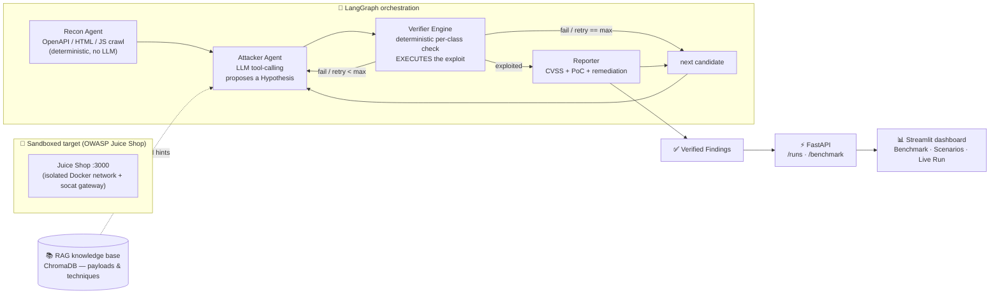

# 🛡️ AutoRedTeam — Autonomous, Execution-Verified Web Pentest Agent

> An autonomous multi-agent system that **finds, exploits, and proves** web-application
> vulnerabilities against a sandboxed target — reporting **only** findings it can actually
> reproduce, so every result ships with a working proof-of-concept and **zero false positives**.

AutoRedTeam pairs an LLM-driven attacker with a **deterministic verification engine**. The
LLM proposes attacks; the engine *executes* them against the live target and confirms the
outcome mechanically. A finding exists only if it was reproduced — which is what separates
this from traditional scanners that emit large volumes of unconfirmed alerts.

- ✅ **Execution-verified findings** — reproduced against the live app, never guessed.
- ✅ **Zero-false-positive by design** — the deterministic verifier is the gatekeeper.
- ✅ **Full artifacts per finding** — CVSS score, reproducible PoC steps, LLM-written remediation.
- ✅ **Honest evaluation** — precision / recall vs. labeled ground truth, and a head-to-head with OWASP ZAP.
- ✅ **Provider-agnostic LLM** — any OpenAI-compatible endpoint (built and run on **Groq**).

---

## Table of Contents
- [Why this exists](#why-this-exists)
- [Architecture](#architecture)
- [How a run works](#how-a-run-works)
- [Vulnerability classes & the verification engine](#vulnerability-classes--the-verification-engine)
- [Project layout](#project-layout)
- [Evaluation & results](#evaluation--results)
- [Getting started](#getting-started)
- [Usage](#usage)
- [Testing](#testing)
- [Safety, scope & ethics](#safety-scope--ethics)
- [Limitations (honest scope)](#limitations-honest-scope)
- [Roadmap / path to a product](#roadmap--path-to-a-product)
- [Tech stack](#tech-stack)

---

## Why this exists

Dynamic application security scanners (DAST) are notoriously **noisy**: they flag hundreds of
*possible* issues, most of which are false positives that a human must triage. In this
project's own head-to-head, OWASP ZAP produced **238 unconfirmed alerts** on the target while
confirming **0** of the in-scope vulnerability classes with proof.

AutoRedTeam inverts that trade-off. Instead of casting a wide, unconfirmed net, it **proves a
smaller set of vulnerabilities by exploiting them**. Each finding is backed by the exact request
that was sent and the observed evidence — so there is nothing to triage. The thesis is simple:

> **A reproduced exploit is worth more than a hundred unconfirmed alerts.**

---

## Architecture

AutoRedTeam is a pipeline of specialized agents orchestrated as a state machine
([LangGraph](https://github.com/langchain-ai/langgraph)). Every LLM and HTTP boundary is
dependency-injected, so each node is pure and unit-testable with fakes — no live model or
network required for tests.



**Design principles**
- **Schemas are the single source of truth.** Every inter-agent message is a Pydantic model in
  [`schemas/models.py`](schemas/models.py). No module redefines these types locally.
- **The verifier uses no LLM.** Confirmation is mechanical and reproducible, so findings are
  deterministic. The LLM only *proposes*; it never *judges* success.
- **Budgeted, scoped network access.** All target traffic goes through a request-budget-scoped
  HTTP client with a host allowlist ([`core/sandbox/client.py`](core/sandbox/client.py)).

---

## How a run works

1. **Recon** crawls the target's attack surface (OpenAPI spec, HTML, and JS assets — Juice Shop
   is an SPA with no OpenAPI spec, so the JS scanner does the heavy lifting). It then bootstraps
   authentication via a pluggable **target adapter** ([`core/orchestration/targets.py`](core/orchestration/targets.py)).
2. The adapter emits **curated candidates** — one per in-scope vulnerability class — each pinned
   to its class and carrying the auth that class needs (e.g. a freshly forged `alg:none` JWT for
   the broken-authentication probe).
3. For each candidate the **Attacker** (LLM, tool-calling, `tool_choice="required"` for
   cross-provider portability) proposes a concrete `Hypothesis` — a payload plus a success
   criterion — optionally informed by the **RAG knowledge base**.
4. The **Verifier** for that class *executes* the payload against the live target and returns a
   deterministic verdict with evidence.
5. On success the **Reporter** scores CVSS (via the `cvss` library — never the LLM), builds
   reproducible PoC steps from the payload + evidence, and generates a remediation (LLM, with an
   offline per-class template fallback).
6. The graph then advances to the next candidate, so a **single run confirms every class it can
   prove** (not just the first).

---

## Vulnerability classes & the verification engine

The verification engine ([`core/verifier/`](core/verifier/)) is the project's core contribution.
Each verifier has a pure, unit-tested decision core:

| Class | How it is **proven** (the oracle) |
|------|-----------------------------------|
| **IDOR** | Attack response for another user's object shares the baseline's JSON *structure* but contains *different data* — confirmed access to someone else's record. |
| **SQLi (error-based)** | A DB error signature appears for the injected request but **not** for a benign baseline (so apps that always error are not flagged). |
| **SQLi (blind / time-based)** | Statistical timing analysis: N benign vs. N delay-injected requests; flagged only when the mean delta matches the injected sleep beyond noise. |
| **Reflected XSS** | A marker payload actually **executes in a real Chromium** (Playwright DOM check), not merely reflected. |
| **Broken Authentication** | A forged, unsigned `alg:none` admin JWT is **accepted** on a protected route (401 → 200). |
| **Path Traversal** | A sentinel file's contents are returned, proving a read outside the intended directory. |
| **SSRF** | An out-of-band callback is received by a controlled listener. |

Absence of proof is **never** treated as proof: an ambiguous result is returned as
`is_exploited=False` with `confidence="llm_judged"` for a future verifier-agent to adjudicate.

### RAG knowledge layer
[`knowledge/`](knowledge/) provides scoped, per-class retrieval of payloads/techniques
(ChromaDB with offline, deterministic hashing embeddings so no embedding model needs to load).
It is wired as an **ablation switch** (RAG on/off), default off, so the baseline behavior is
unchanged and the knowledge layer's contribution can be measured.

---

## Project layout

```
.
├── api/                  # FastAPI app — run lifecycle (/runs) + benchmark endpoints (/benchmark)
├── core/
│   ├── agents/           # recon (deterministic), attacker (LLM), reporter (CVSS/PoC/remediation)
│   ├── orchestration/    # LangGraph graph, run state, pluggable target adapters
│   ├── sandbox/          # request-budget-scoped, host-allowlisted HTTP client
│   └── verifier/         # deterministic per-class verifiers (the verification engine)
├── knowledge/            # RAG layer — embeddings, ingest, retrieval, starter corpus
├── evals/                # ground truth, metrics, benchmark runner, scenarios, saved results
├── dashboard/            # Streamlit cockpit (Benchmark · Scenarios · Live Run)
├── schemas/              # Pydantic models — the single source of truth for all messages
├── scripts/              # live-demo scripts + snapshot generator
├── markdown/             # design/spec docs (00–09) and the build roadmap
├── docker-compose.sandbox.yml   # isolated target + socat gateway
├── REPORT.md             # full capstone write-up (problem, method, results, evaluation)
└── requirements.txt
```

---

## Evaluation & results

Scored against a **labeled ground truth** of the target's documented vulnerabilities
([`evals/ground_truth.py`](evals/ground_truth.py)). Results below are from live runs against
OWASP Juice Shop using Groq `openai/gpt-oss-120b`.

**Engine mode** (deterministic verifier on canonical payloads — fully reproducible):

| Metric (in-scope) | Value |
|---|---|
| Precision | **1.00** |
| Recall | **1.00** |
| False-positive rate | **0.00** |
| Avg attempts-to-success | **1.00** |

**Agent mode** (full LLM attacker, mean ± stddev across seeds): in-scope recall **1.00 ± 0.00**,
precision **1.00 ± 0.00** — confirming the result is reproducible, not a lucky seed.

**Scope honesty:** scored against *all* documented vulnerabilities (including classes the system
is deliberately not designed to verify), recall is **4 / 7 ≈ 0.57** — reported transparently
rather than against a cherry-picked denominator.

**Head-to-head vs. OWASP ZAP (passive):** ZAP produced **238 raw alerts** (170 Medium /
68 Informational) and confirmed **0** in-scope classes with proof. AutoRedTeam confirmed **4**,
every one backed by a reproducible PoC. **Signal, not noise.**

> See [`REPORT.md`](REPORT.md) for the full write-up, methodology, and per-class detail.

---

## Getting started

### Prerequisites
- **Python 3.11+** (developed on 3.13)
- **Docker Desktop** (for the sandboxed target)
- An **OpenAI-compatible LLM key** — e.g. a free [Groq](https://console.groq.com/keys) key

### 1. Install
```bash
pip install -r requirements.txt
python -m playwright install chromium   # for the XSS DOM verifier
```

### 2. Configure the LLM
```bash
cp .env.example .env     # then edit .env with your key
```
Or export directly (the API/agent read these from the environment):
```bash
export GROQ_API_KEY=your_key
export AUTOREDTEAM_LLM_BASE_URL=https://api.groq.com/openai/v1
export AUTOREDTEAM_LLM_MODEL=openai/gpt-oss-120b
```

### 3. Start the sandboxed target
```bash
docker compose -f docker-compose.sandbox.yml up -d
```
The target runs on an **isolated Docker network with no egress**; a trusted `socat` gateway
bridges the host to it at `http://127.0.0.1:3000`.

---

## Usage

### Run the API + dashboard
```bash
# Terminal 1 — API (port 8000 is often busy; 8077 is a safe alternative)
uvicorn api.main:app --port 8077

# Terminal 2 — dashboard
streamlit run dashboard/app.py
```
Open the dashboard, set the sidebar **API base URL** to `http://127.0.0.1:8077`, and use:
- **📊 Benchmark** — precision/recall KPIs, per-class results, the ZAP noise comparison, glossary.
- **🧪 Scenarios** — each scenario's expected-vs-actual verdict (true positives, correct non-alarms, honest out-of-scope misses).
- **🚀 Live Run** — point at `http://127.0.0.1:3000` and watch the agent confirm every verifiable class live.

### Run the benchmark from the CLI
```bash
python -m evals.run_benchmark http://127.0.0.1:3000
```

### Quick live checks (scripts)
```bash
python scripts/run_idor_live.py          # single-class live proof
python scripts/run_phase5_live.py        # multi-class verification demo
python scripts/make_snapshots.py         # regenerate the bundled dashboard snapshot
```

---

## Testing

```bash
pytest -q
```
The suite is **fully offline** — all LLM/HTTP/Docker boundaries are mocked — so it runs anywhere
with no key, no network, and no containers. It covers the verifiers, agents, orchestration graph,
RAG layer, metrics, and the API.

---

## Safety, scope & ethics

- **Authorized targets only.** AutoRedTeam is built for a **sandboxed, intentionally vulnerable
  target you run yourself** (OWASP Juice Shop). The target is network-isolated with no egress.
- **Never point it at systems you do not own or are not explicitly authorized to test.** This is
  an exploitation tool; unauthorized use is illegal.
- **Budgeted & scoped.** All traffic is capped by a request budget and restricted to a host
  allowlist, so a run cannot wander off-target or hammer the app.

---

## Limitations (honest scope)

- **Four verifiable classes on Juice Shop.** The system *proves* IDOR, error-based SQLi, reflected
  XSS, and broken auth on this target. Blind SQLi, path traversal, and SSRF are **code-complete and
  unit-tested** but need a different target to demonstrate (SQLite has no `SLEEP()`, Juice Shop has
  no OS-file-read oracle, and SSRF needs an out-of-band listener). This is **not** a 100-challenge
  scoreboard solver — it is a *verification engine*.
- **Single target adapter.** Authentication and candidate endpoints are currently specific to
  Juice Shop; arbitrary apps need a pluggable `AuthProvider` (see roadmap).
- **Small benchmark denominator.** Metrics are illustrative of behavior on one target, not a
  statistically large benchmark — hence the deliberately honest reporting.

---

## Roadmap / path to a product

- **Pluggable authentication** — a `BringYourOwnToken` / cookie / recorded-login `AuthProvider` to
  replace the Juice-Shop-specific bootstrap, unlocking arbitrary apps.
- **Generic, hint-free discovery** — drive the attacker from recon + RAG alone (no curated probes).
- **More verifiers** — CSRF, BOLA/access-control, mass assignment, open redirect, SSRF via an OAST listener.
- **Productization** — SQLite persistence (currently in-memory), SARIF export → CI / GitHub Security,
  scheduled scans, scope/authorization gates, multi-app evaluation (DVWA, WebGoat, crAPI, VAmPI).

---

## Tech stack

**Python** · **Pydantic** (schemas) · **LangGraph** (orchestration) · **FastAPI** +
**Uvicorn** (API) · **Streamlit** + **Altair** (dashboard) · **httpx** (networking) ·
**Playwright/Chromium** (XSS verification) · **ChromaDB** (RAG) · **cvss** (scoring) ·
**OpenAI-compatible LLM on Groq** · **Docker** (sandbox) · **pytest** / **pytest-asyncio** (76 tests).

---

> **Disclaimer.** AutoRedTeam is a research / educational project for authorized security testing
> against intentionally vulnerable, sandboxed targets. The authors are not responsible for misuse.
